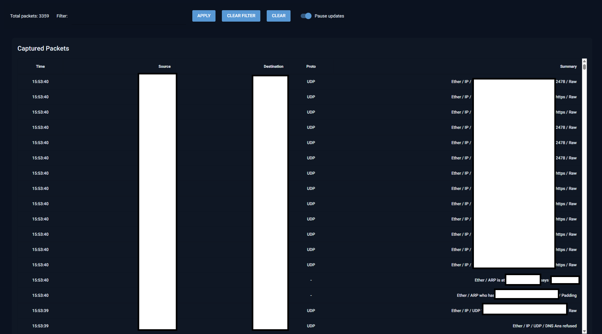

# Python Shark

A simple packet-capture UI built with NiceGUI and scapy.



## Overview

- Live packet capture using scapy running in a background thread.
- NiceGUI frontend shows a compact table of captured packets, newest first, with time, source, destination, protocol and scapy's summary line.
- A text filter matches on source, destination or summary. A switch pauses table updates, and a button clears the captured rows. The filter and the pause switch apply to one browser tab. The captured rows are shared by all tabs.

## Quick start

Requires Python 3.11 or newer.

1. Create and activate a virtual environment.

   Bash (Linux, macOS):

   ```bash
   python3 -m venv .venv
   source .venv/bin/activate
   ```

   PowerShell:

   ```powershell
   python -m venv .venv
   .\.venv\Scripts\Activate.ps1
   ```

2. Install the project and its dev dependencies as an editable install:

   ```bash
   python -m pip install --upgrade pip
   python -m pip install -e ".[dev]"
   ```

3. Run the app from the repository root:

   ```bash
   python -m app.main
   ```

Open http://localhost:8080 in your browser.

Packet capture usually needs elevated privileges: root or the `CAP_NET_RAW` capability on Linux, and Npcap on Windows. Without them the sniffer thread logs `Sniffer failed` and the table stays empty.

## How it works

`main()` in `app/main.py` starts `scapy.sniff` in a daemon thread and then the NiceGUI server. The sniff callback converts each packet to a row and adds it to a lock-protected store that keeps the most recent 5000 rows. Each browser tab gets its own page with a timer that runs once a second and copies the store into the table when the store has changed, so the UI is only touched from the NiceGUI event loop. Importing `app.main` starts neither the sniffer nor the server.

- `app/main.py`: capture thread, row conversion, row store, page function and server entry point
- `app/frontend.py`: page layout, controls and the filter function
- `app/ui_assets.py`: CSS and the light/dark theme script

## Tests

Run the test suite (from the repo root):

```bash
python -m pytest -q
```

The tests cover the packet-to-row conversion on scapy packets, the row store, the filter function, and that importing `app.main` does not start the sniffer. The CI workflow at `.github/workflows/ci.yml` runs pytest on push and pull request.

## Limitations

- The Proto column names only TCP and UDP. Other IPv4 packets show the IP protocol number, and non-IPv4 packets such as ARP and IPv6 show `-` for source, destination and protocol.
- Pausing stops table updates, not capture. Rows captured while paused appear when updates resume, up to the 5000-row limit.
- There is no interface selection or capture filter. scapy sniffs on its default interface.
